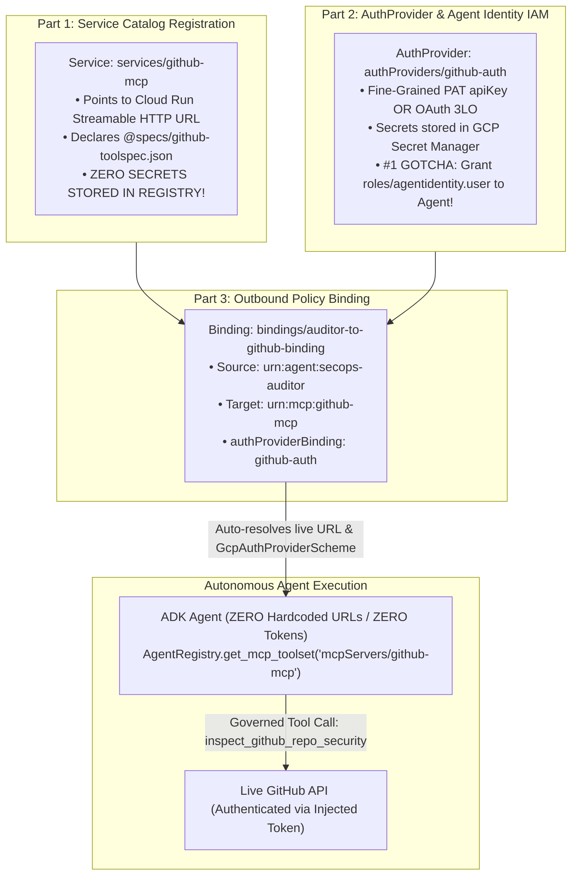

# Advent of Agents Season 3 (Day 19): Dynamic MCP Governance & 3P Auth Brokerage

[](https://cloud.google.com/agent-registry)
[](https://cloud.google.com/agent-identity)
[](https://cloud.google.com/security/model-armor)
[](https://github.com/google/adk)
[](https://cloud.google.com/vertex-ai)

> **Eliminating Hardcoded Tool Endpoints and Local Secret Proliferation in Autonomous AI Agents using Google Cloud Agent Registry, Agent Identity AuthProviders, Outbound Bindings, and Model Armor.**

---

## The Challenge: Why Engineers Get Stuck on 3P MCP Servers (GitHub / Figma)

In real-world enterprise agent deployments, engineers face two massive roadblocks:
1. **Hardcoded Endpoint Anti-Pattern:** Client agents hardcode MCP server URLs (`https://.../mcp`). When endpoints migrate, fail over, or undergo blue/green version upgrades, agents break and require code redeployments.
2. **Secret Proliferation Anti-Pattern:** Third-party MCP servers like **GitHub** or **Figma** require authentication. Developers frequently commit tokens (`GITHUB_TOKEN`, `FIGMA_PAT`) into `.env` files, container images, or agent source code, creating serious security vulnerabilities.

---

## The Solution: The 3-Part Handshake for Governed 3P MCP Servers

Google Cloud **Agent Registry** (`agentregistry.googleapis.com`) and **Agent Identity** (`agentidentity.googleapis.com`) solve this via a decoupled 3-Part Handshake:



### 1. Part 1 — Register the Service (`agentregistry.googleapis.com`)
Register `services/github-mcp` declaring its tools (`inspect_github_repo_security`, `audit_latest_commits`) and pointing to the physical Streamable HTTP endpoint (`v1` cutover to `v2`).
> **CRITICAL RULE:** The Service Catalog holds **ZERO SECRETS**. It describes only capabilities and interfaces.

### 2. Part 2 — Create the AuthProvider & Grant IAM (`agentidentity.googleapis.com`)
Configure `projects/{PROJECT_ID}/locations/{REGION}/authProviders/github-auth`:
- **Fine-Grained PAT (`apiKey`)**: Tokens are securely stored in GCP Secret Manager (`projects/{PROJECT_ID}/secrets/github-mcp-pat`).
- **OAuth 3LO (`threeLeggedOauth`)**: For interactive user-delegated authorization:
  ```json
  {
    "threeLeggedOauth": {
      "clientId": "your-github-oauth-client-id",
      "authorizationUrl": "https://github.com/login/oauth/authorize",
      "tokenUrl": "https://github.com/login/oauth/access_token",
      "redirectUrl": "https://iamconnectorcredentials.googleapis.com/v1/projects/{project}/locations/{region}/connectors/github-auth/oauthcallback"
    }
  }
  ```
- **🚨 THE #1 GOTCHA PEOPLE MISS:**  
  You **MUST** grant the Agent Principal (Compute Service Account or User) `roles/agentidentity.user` on the AuthProvider resource:
  ```bash
  gcloud agent-identity auth-providers add-iam-policy-binding github-auth \
    --location=us-central1 \
    --member="serviceAccount:${PROJECT_NUMBER}-compute@developer.gserviceaccount.com" \
    --role="roles/agentidentity.user"
  ```
  Without this IAM grant, runtime credential retrieval fails with `PERMISSION_DENIED`!

### 3. Part 3 — Wire the Outbound Binding (`bindings/auditor-to-github-binding`)
Create the administrative policy linking the source agent to the target tool:
```json
{
  "displayName": "SecOps Auditor to GitHub MCP Binding",
  "source": { "identifier": "urn:agent:secops-auditor" },
  "target": { "identifier": "urn:mcp:github-mcp" },
  "authProviderBinding": {
    "authProvider": "projects/bu2-prod-data/locations/us-central1/authProviders/github-auth",
    "scopes": ["repo", "read:org"]
  }
}
```

In Google ADK (`google-adk >= 1.29.0`), calling:
```python
from google.adk.integrations.agent_registry import AgentRegistry

registry = AgentRegistry(project=PROJECT_ID, location=REGION)
toolset = registry.get_mcp_toolset("mcpServers/github-mcp")
```
automatically validates the Outbound Binding, resolves the live endpoint URL, and attaches `GcpAuthProviderScheme` credentials with zero manual header boilerplate!

---

## 5-Command High-Impact Stage Show (<4 Minutes)

The stage show simulates live typing with a stationary, high-contrast visual HUD:

```bash
# Launch interactive auto-typing stage show:
./run_day19_stage_show.sh

# Or tap any keys to type live (HackerTyper style):
./run_day19_stage_show.sh --live-keys

# Or run non-interactive verification:
./run_day19_stage_show.sh --non-interactive
```

### The 5 Punchy Commands Executed:

1. **Act 1 — Onboard GitHub MCP + AuthProvider + Binding:**
   ```bash
   python3 registry_control_plane.py onboard-github
   ```
   *Executes the 3-Part Handshake, establishes Secret Manager PAT / Agent Identity AuthProvider, and displays the CQRS projection table.*

2. **Act 2 — Dynamic Resolution & Bound-Auth Invocation of `github-mcp-v1`:**
   ```bash
   python3 dynamic_mcp_agent.py
   ```
   *Agent dynamically discovers `v1` endpoint via Agent Registry, queries real GitHub repo security posture via Gemini 2.5 Flash, with zero hardcoded URLs and zero secrets in code.*

3. **Act 3a — Zero-Downtime Cutover from `github-mcp-v1` to `github-mcp-v2`:**
   ```bash
   python3 registry_control_plane.py cutover-v2
   ```
   *Updates physical URI to `v2.0-GHAS-PQC-HARDENED`. Displays Before vs. After diff proving Logical URN and Binding stay 100% invariant.*

4. **Act 3b — Re-Run Agent with Zero Code Changes against `github-mcp-v2`:**
   ```bash
   python3 dynamic_mcp_agent.py
   ```
   *Same agent runs with ZERO code changes. Seamlessly receives v2 hardened audit with branch protection, secret scanning, and ML-DSA-65 post-quantum signatures.*

5. **Act 4 — Central Kill-Switch & Immediate Verification:**
   ```bash
   python3 registry_control_plane.py revoke && python3 dynamic_mcp_agent.py
   ```
   *SecOps emergency kill switch deletes Outbound Binding. Downstream agent tool call is blocked instantly at runtime.*

---

## Repository Structure

```
.
├── specs/
│   ├── github-toolspec.json    # Declarative GitHub MCP ToolSpec with behavioral hints
│   └── agent-card.json         # A2A v1.0 Agent Card specification
├── terraform/
│   ├── main.tf                 # Complete IaC for 3-part handshake + Figma bonus
│   ├── variables.tf            # Parameterized GCP variables
│   └── outputs.tf              # Resource URNs & AuthProvider outputs
├── mcp_servers/
│   ├── github_mcp_server.py    # Cloud Run FastMCP server querying GitHub API
│   ├── github_v1/              # Dockerfile for v1.0-GITHUB-MCP-BASIC
│   └── github_v2/              # Dockerfile for v2.0-GHAS-PQC-HARDENED
├── deploy_cloud_run_mcp.sh     # Cloud Run deployment script with Secret Manager injection
├── registry_control_plane.py   # Admin CLI for 3-part handshake, cutover, and revocation
├── dynamic_mcp_agent.py        # Autonomous ADK Agent with ZERO hardcoded URLs & ZERO secrets
├── stage_show_driver.py        # 5-command simulated typing driver with stationary HUD
├── run_day19_stage_show.sh     # Studio recording stage show runner
└── requirements.txt            # Python dependencies (pinned mcp==1.30.0, google-adk, rich)
```

---

## 5-Minute Setup in Your Own GCP Project

```bash
# 1. Clone repository
git clone https://github.com/arobinson12/advent-of-agents-s3-day19-mcp-governance.git
cd advent-of-agents-s3-day19-mcp-governance

# 2. Set environment variables
export PROJECT_ID="your-project-id"
export REGION="us-central1"
gcloud config set project "$PROJECT_ID"

# 3. Enable required Google Cloud APIs
gcloud services enable \
  agentregistry.googleapis.com \
  agentidentity.googleapis.com \
  secretmanager.googleapis.com \
  modelarmor.googleapis.com \
  run.googleapis.com \
  aiplatform.googleapis.com

# 4. Deploy Cloud Run MCP servers
./deploy_cloud_run_mcp.sh

# 5. Run the 5-command stage show
./run_day19_stage_show.sh
```

---

## Bonus: Figma MCP AuthProvider Example

In `terraform/main.tf`, you can also inspect how to register **Figma MCP** (`services/figma-mcp`) using an OAuth 3LO AuthProvider (`authProviders/figma-auth`) with deterministic GCP callback redirects:
```hcl
resource "google_agent_identity_auth_provider" "figma_auth" {
  provider_id = "figma-auth"
  location    = "us-central1"
  three_legged_oauth {
    client_id         = var.figma_client_id
    authorization_url = "https://www.figma.com/oauth"
    token_url         = "https://api.figma.com/v1/oauth/token"
    redirect_url      = "https://iamconnectorcredentials.googleapis.com/v1/projects/${var.project_id}/locations/${var.region}/connectors/figma-auth/oauthcallback"
  }
}
```

---

## License

Apache License 2.0. See [LICENSE](LICENSE) for details.
