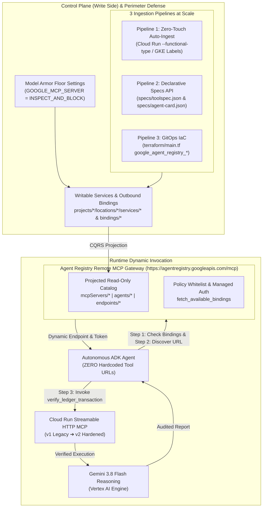

# Advent of Agents Season 3 (Day 19): Dynamic MCP Governance, Tool Registry & Outbound Bindings

[](https://cloud.google.com/agent-registry)
[](https://cloud.google.com/security/model-armor)
[](https://github.com/google/adk)
[](https://cloud.google.com/vertex-ai)

> **Eliminating Hardcoded Tool Endpoints in Autonomous AI Agents using Google Cloud Agent Registry, Outbound Bindings, and Model Armor.**

---

## Overview & Architecture: The CQRS Data Model

In production AI systems, **hardcoded tool URLs are an anti-pattern**:
* **Configuration Debt & Fragility:** Tool endpoints migrate, scale, or rotate certificates. Hardcoded URLs break client agents and force code redeployments.
* **Shadow AI & Tool Sprawl:** SecOps loses visibility into what tools agents call and what permissions they possess.
* **Perimeter Vulnerabilities:** Without central governance and perimeter inspection, agents are vulnerable to indirect prompt injection, rogue tool substitution, and sensitive data leakage.

Google Cloud **Agent Registry Remote MCP Server** (`https://agentregistry.googleapis.com/mcp`) implements a **CQRS (Command Query Responsibility Segregation) architecture**:
1. **Writable Control Plane (`services/*`, `bindings/*`):** Platform engineers and SecOps manage workloads via declarative specs, Terraform IaC, or compute auto-ingest.
2. **Projected Read-Only Catalog (`mcpServers/*`, `agents/*`, `endpoints/*`):** Consumer agents query indexed URNs, dynamic connection interfaces, and schema capabilities with zero hardcoded URLs.
3. **Outbound Bindings & Perimeter Enforcement:** Explicit policy whitelist linking autonomous agents to vetted tools, protected by **Model Armor Floor Settings** (`GOOGLE_MCP_SERVER = INSPECT_AND_BLOCK`).



---

## The 3 Enterprise Onboarding Pipelines

| Pipeline | Target Workload | Implementation & Artifacts | Enterprise Advantage |
|---|---|---|---|
| **Pipeline 1: Zero-Touch Compute Auto-Discovery** | Cloud Run & GKE (MCP Servers & Agents) | **Cloud Run:** `--functional-type=mcp-server`<br>or `--functional-type=agent --identity-type=agent-identity`<br>**GKE:** Label `registry.gke.io/functional-type: "MCP_SERVER"` (`k8s/gke-auto-register.yaml`). | Automated continuous cataloging as workloads deploy. Zero manual registration steps. |
| **Pipeline 2: Declarative Services API & CLI** | Custom Tools, A2A Agents, & REST Endpoints | **MCP:** `specs/toolspec.json` (`mcpServerSpec.type = TOOL_SPEC`)<br>**Agent:** `specs/agent-card.json` (`agentSpec.type = A2A_AGENT_CARD`)<br>**REST:** `swift-sanctions-api` (`endpointSpec.type = NO_SPEC`). | Central SecOps vetting of third-party APIs, SaaS, legacy endpoints, and custom agents. |
| **Pipeline 3: GitOps & Terraform IaC** | Enterprise Fleet Infrastructure | **HCL:** `terraform/main.tf`<br>`resource "google_agent_registry_service"`<br>`resource "google_agent_registry_binding"` | Reproducible CI/CD pipelines, peer-reviewed Git pull requests, and automated compliance. |

---

## Repository File Manifest

```
.
├── README.md                   # Complete architectural guide & 5-minute quickstart
├── specs/
│   ├── toolspec.json           # Declarative MCP ToolSpec schema with behavioral hints (Pipeline 2)
│   └── agent-card.json         # Official A2A v1.0 Agent Card specification (Pipeline 2)
├── terraform/
│   ├── main.tf                 # Terraform IaC for Agent Registry services & bindings (Pipeline 3)
│   ├── variables.tf            # Parameterized GCP variables
│   └── outputs.tf              # URN and Binding resource outputs
├── k8s/
│   └── gke-auto-register.yaml  # GKE Deployment manifests with auto-discovery labels (Pipeline 1)
├── deploy_cloud_run_mcp.sh     # Cloud Run deployment script with auto-discovery flags (Pipeline 1)
├── registry_control_plane.py   # Admin CLI executing Agent Registry Remote MCP tools & bindings
├── dynamic_mcp_agent.py        # Governed ADK Agent with Outbound Bindings & ZERO hardcoded URLs
├── stage_show_driver.py        # Theatrical Stage Show Driver (Simulated Typing + Persistent HUD)
├── run_day19_stage_show.sh     # Wrapper script for running the studio recording stage show
├── requirements.txt            # Python dependencies (google-adk, fastmcp, rich, httpx, etc.)
├── .env.example                # Customer environment configuration template
├── mcp_servers/
│   ├── ledger_v1/              # Streamable HTTP MCP Server v1.0 Legacy (Cloud Run)
│   └── ledger_v2/              # Streamable HTTP MCP Server v2.0 Post-Quantum Hardened (Cloud Run)
└── kata/
    ├── discover_and_govern_mcp.sh # 300-second curl workflow script
    └── dynamic_mcp_agent.py       # Concise dynamic ADK agent with bindings
```

---

## 5-Minute Quickstart: Try It in Your Own GCP Project

Follow these steps to deploy and run the dynamic MCP governance demo in your own Google Cloud project.

### 1. Prerequisites & API Activation

Ensure you have the Google Cloud SDK (`gcloud`), Python 3.11+, and an active Google Cloud Project:

```bash
# Set your target GCP project
export PROJECT_ID="your-project-id"
export REGION="us-central1"
gcloud config set project "$PROJECT_ID"

# Enable required Google Cloud APIs
gcloud services enable \
  agentregistry.googleapis.com \
  modelarmor.googleapis.com \
  run.googleapis.com \
  aiplatform.googleapis.com \
  iam.googleapis.com

# Authorize Application Default Credentials
gcloud auth application-default login
```

### 2. Install Python Dependencies

```bash
python3 -m venv .venv
source .venv/bin/activate
pip install -r requirements.txt
```

### 3. Deploy Cloud Run MCP Servers (Pipeline 1: Compute Auto-Discovery)

Deploy the sample FastMCP servers (`v1` and `v2`) with the `--functional-type=mcp-server` discovery flag:

```bash
./deploy_cloud_run_mcp.sh
```

### 4. Configure Model Armor Floor Settings

Enforce project-wide Model Armor protection for all Google Cloud MCP servers:

```bash
TOKEN=$(gcloud auth application-default print-access-token)
curl -X PATCH \
  -H "Authorization: Bearer ${TOKEN}" \
  -H "x-goog-user-project: ${PROJECT_ID}" \
  -H "Content-Type: application/json" \
  "https://modelarmor.googleapis.com/v1/projects/${PROJECT_ID}/locations/global/floorSetting?updateMask=enableFloorSettingEnforcement,integratedServices,googleMcpServerFloorSetting" \
  -d '{
    "enableFloorSettingEnforcement": true,
    "integratedServices": ["MODEL_ARMOR_INTEGRATED_SERVICE_GOOGLE_MCP_SERVER"],
    "googleMcpServerFloorSetting": {
      "inspectAndBlock": true
    }
  }'
```

---

## Running the Theatrical Stage Show

The stage show includes **simulated human typing** and a **persistent visual Governance Control Plane HUD** on screen:

```bash
# 1. Default Recording Mode (Auto-types command on [ENTER] or [SPACE]):
./run_day19_stage_show.sh

# 2. Live Keypress Mode (Tap any keyboard keys to type command live on screen):
./run_day19_stage_show.sh --live-keys

# 3. Headless Automated Verification Mode:
./run_day19_stage_show.sh --non-interactive
```

### The 4 Acts & 10 Auto-Typed Commands

#### Act 1: The Problem & Scale Architecture (Commands 1–3)
1. `python3 registry_control_plane.py show-onboarding-specs`  
   *Examines all 3 Onboarding Pipelines, ToolSpec schemas, Agent Cards, and Terraform IaC.*
2. `python3 registry_control_plane.py list-meta-tools`  
   *Discovers the 20 built-in governance tools on `https://agentregistry.googleapis.com/mcp`.*
3. `python3 registry_control_plane.py onboard-all`  
   *Onboards MCP Server (`v1.0`), A2A Agent, REST Endpoint, and Outbound Binding.*

#### Act 2: Zero-Hardcoded-URL Autonomous Execution (Commands 4–5)
4. `python3 registry_control_plane.py inspect-catalog`  
   *Inspects CQRS Projection table mapping writable services to read-only collections.*
5. `python3 dynamic_mcp_agent.py`  
   *Executes governed ADK agent resolving approved bindings and verifying ledger transactions via Gemini 3.8 Flash.*

#### Act 3: Zero-Downtime Governance Cutover (Commands 6–7)
6. `python3 registry_control_plane.py cutover-v2`  
   *Promotes `v2.0-ZERO-TRUST-HARDENED` endpoint. Proves Logical URN and Binding stay 100% invariant.*
7. `python3 dynamic_mcp_agent.py`  
   *Executes same agent with ZERO code changes. Seamlessly routes to v2.*

#### Act 4: Emergency Revocation & Model Armor Kill Switch (Commands 8–10)
8. `python3 registry_control_plane.py revoke`  
   *SecOps emergency kill switch deletes Outbound Binding and Service registration.*
9. `python3 dynamic_mcp_agent.py`  
   *Agent attempts tool execution and is instantly blocked at runtime by Central Governance.*
10. `python3 registry_control_plane.py onboard-all`  
    *Resets environment to clean v1 ready-state for the next recording take.*

---

## 300-Second Developer Kata

For a lightning-fast demonstration using curl and lightweight Python:

```bash
cd kata
./discover_and_govern_mcp.sh
python3 dynamic_mcp_agent.py
```

---

## License

Apache License 2.0. See [LICENSE](LICENSE) for details.
