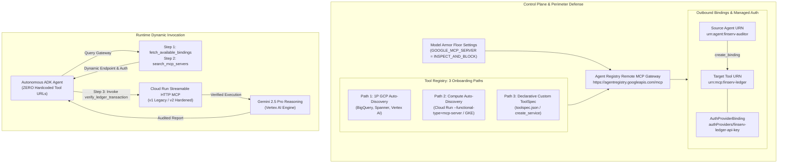

# Advent of Agents Season 3 (Day 19): Dynamic MCP Governance, Tool Registry & Outbound Bindings

[](https://cloud.google.com/agent-registry)
[](https://cloud.google.com/security/model-armor)
[](https://github.com/google/adk)
[](https://cloud.google.com/vertex-ai)

> **Eliminating Hardcoded Tool Endpoints in Autonomous AI Agents using Google Cloud Agent Registry, Outbound Bindings, and Model Armor.**

---

## Overview & Architecture

In production AI systems, **hardcoded tool URLs are an anti-pattern**:
* **Configuration Debt & Fragility:** Tool endpoints migrate, scale, or rotate certificates. Hardcoded URLs break client agents and force code redeployments.
* **Shadow AI & Tool Sprawl:** SecOps loses visibility into what tools agents call and what permissions they possess.
* **Perimeter Vulnerabilities:** Without central governance and perimeter inspection, agents are vulnerable to indirect prompt injection, rogue tool substitution, and sensitive data leakage.

Google Cloud **Agent Registry Remote MCP Server** (`https://agentregistry.googleapis.com/mcp`) solves this by acting as a **centralized, zero-trust control plane** for Model Context Protocol (MCP) servers, backed by **Outbound Bindings** and **Model Armor Floor Settings**.



---

## The 5 Day 19 Pillars

| Pillar | Capability | Description |
|---|---|---|
| **1. Tool Registry Onboarding** | All 3 Ingestion Paths | **Path 1:** 1P GCP Auto-Discovery (enabling BigQuery/Vertex APIs).<br>**Path 2:** Compute Auto-Discovery (`--functional-type=mcp-server` on Cloud Run, `registry.gke.io/functional-type: "MCP_SERVER"` on GKE).<br>**Path 3:** Declarative Custom ToolSpec (`toolspec.json` via `create_service`). |
| **2. Agent Registry MCP** | Remote Governance Gateway | Built-in meta-tools exposed at `https://agentregistry.googleapis.com/mcp` (`search_mcp_servers`, `create_service`, `create_binding`, `fetch_available_bindings`, `delete_binding`). |
| **3. Outbound Bindings** | Explicit Zero-Trust Authorization | Policy whitelist linking `urn:agent:finserv-auditor` to `urn:mcp:finserv-ledger` with native `AuthProviderBinding` (managed API Keys / OAuth). Agents never store secrets in code. |
| **4. Dynamic ADK Invocation** | Zero Hardcoded URLs | Google ADK dynamically evaluates Outbound Bindings, discovers endpoints at runtime, binds `McpToolset`, and audits transactions via Gemini 2.5 Pro. |
| **5. Managing Tools at Scale** | Cutover, Kill-Switch & Floor Settings | Zero-downtime cutover (`cutover-v2`), central rogue tool quarantine (`revoke`), and project-wide Model Armor Floor Settings (`INSPECT_AND_BLOCK`). |

---

## Repository File Manifest

```
.
├── README.md                   # Complete architectural guide & 5-minute quickstart
├── toolspec.json               # Declarative ToolSpec schema (Path 3 Onboarding)
├── deploy_cloud_run_mcp.sh     # Cloud Run deployment script with auto-discovery flags (Path 2)
├── registry_control_plane.py   # Admin CLI executing Agent Registry Remote MCP tools & bindings
├── dynamic_mcp_agent.py        # Governed ADK Agent with Outbound Bindings & ZERO hardcoded URLs
├── run_day19_stage_show.sh     # Interactive / non-interactive 4-act theatrical runner
├── requirements.txt            # Python dependencies (google-adk, fastmcp, rich, etc.)
├── .env.example                # Customer environment configuration template
├── mcp_servers/
│   ├── ledger_v1/              # Streamable HTTP MCP Server v1.0 Legacy (Cloud Run)
│   └── ledger_v2/              # Streamable HTTP MCP Server v2.0 Post-Quantum Hardened (Cloud Run)
└── kata/
    ├── discover_and_govern_mcp.sh # 300-second curl workflow script
    └── dynamic_mcp_agent.py       # Concise, copy-pasteable dynamic ADK agent with bindings
```

---

## 5-Minute Quickstart: Try It in Your Own GCP Project

Follow these steps to deploy and run the dynamic MCP governance demo in your own Google Cloud project.

### 1. Prerequisites & API Activation

Ensure you have the Google Cloud SDK (`gcloud`), Python 3.11+, and an active Google Cloud Project:

```bash
# Set your target GCP project
export PROJECT_ID="your-project-id"
export REGION="us-central1"
gcloud config set project "$PROJECT_ID"

# Enable required Google Cloud APIs
gcloud services enable \
  agentregistry.googleapis.com \
  modelarmor.googleapis.com \
  run.googleapis.com \
  aiplatform.googleapis.com \
  iam.googleapis.com

# Authorize Application Default Credentials
gcloud auth application-default login
```

### 2. Install Python Dependencies

```bash
python3 -m venv .venv
source .venv/bin/activate
pip install -r requirements.txt
```

### 3. Deploy Cloud Run MCP Servers (Path 2: Compute Auto-Discovery)

Deploy the sample FastMCP servers (`v1` and `v2`) with the `--functional-type=mcp-server` discovery flag:

```bash
./deploy_cloud_run_mcp.sh
```

Copy the generated `LEDGER_V1_URL` and `LEDGER_V2_URL` outputs into `.env` (or let the scripts discover them automatically).

### 4. Configure Model Armor Floor Settings

Enforce project-wide Model Armor protection for all Google Cloud MCP servers:

```bash
TOKEN=$(gcloud auth application-default print-access-token)
curl -X PATCH \
  -H "Authorization: Bearer ${TOKEN}" \
  -H "x-goog-user-project: ${PROJECT_ID}" \
  -H "Content-Type: application/json" \
  "https://modelarmor.googleapis.com/v1/projects/${PROJECT_ID}/locations/global/floorSetting?updateMask=enableFloorSettingEnforcement,integratedServices,googleMcpServerFloorSetting" \
  -d '{
    "enableFloorSettingEnforcement": true,
    "integratedServices": ["MODEL_ARMOR_INTEGRATED_SERVICE_GOOGLE_MCP_SERVER"],
    "googleMcpServerFloorSetting": {
      "inspectAndBlock": true
    }
  }'
```

---

## Running the 4-Act Stage Show

You can run the entire show interactively:
```bash
./run_day19_stage_show.sh
```
Or run the non-interactive automated test:
```bash
./run_day19_stage_show.sh --non-interactive
```

### Detailed Act-by-Act Guide

#### Act 1: The Trap, Tool Registry Onboarding & Outbound Bindings
Show how hardcoded endpoints introduce vulnerabilities and explore the Agent Registry control plane:

```bash
# 1. Discover built-in governance tools on Agent Registry Remote MCP Server
python3 registry_control_plane.py list-meta-tools

# 2. Review all 3 Tool Registry Onboarding Paths
python3 registry_control_plane.py explain-paths

# 3. Register FinServ Ledger MCP (Path 3 ToolSpec) and Outbound Binding
python3 registry_control_plane.py register-v1

# 4. Inspect active Outbound Bindings
python3 registry_control_plane.py inspect-bindings
```

#### Act 2: Dynamic Outbound Binding Resolution (Zero Hardcoded URLs)
Execute the client agent. Observe how `dynamic_mcp_agent.py` contains **zero hardcoded URLs**:

```bash
python3 dynamic_mcp_agent.py
```
*Output Workflow:*
* **[Step 1]**: Calls `fetch_available_bindings` to verify approved authorization to `urn:mcp:finserv-ledger`.
* **[Step 2]**: Calls `search_mcp_servers` to dynamically resolve the live `v1.0-LEGACY` endpoint.
* **[Step 3]**: Attaches managed auth credentials and verifies transaction `TX-9941` with Gemini 2.5 Pro.

#### Act 3: Zero-Downtime Governance Cutover (v1 -> v2)
SecOps upgrades the production tool to `v2.0-ZERO-TRUST-HARDENED` with Post-Quantum Cryptography (ML-DSA-65 signatures). The Outbound Binding is preserved:

```bash
# Admin performs cutover in central registry
python3 registry_control_plane.py cutover-v2

# Run the exact same agent without changing a single line of client code!
python3 dynamic_mcp_agent.py
```
*Output:* Agent immediately discovers the v2 endpoint and receives the post-quantum hardened verification response!

#### Act 4: Outbound Binding Revocation & Instant Kill-Switch
SecOps detects a rogue tool or policy breach and triggers the emergency kill-switch:

```bash
# Admin revokes Outbound Binding and Service registration
python3 registry_control_plane.py revoke

# Agent attempts execution
python3 dynamic_mcp_agent.py
```
*Output:* Central registry returns 0 approved Outbound Bindings. Execution is immediately blocked at Step 1:
`[POLICY ENFORCEMENT BLOCK] Central Governance revoked Outbound Binding for 'urn:agent:finserv-auditor'! 0 approved Outbound Bindings found.`

---

## 300-Second Developer Kata

For a lightning-fast demonstration using curl and lightweight Python:

```bash
cd kata
./discover_and_govern_mcp.sh
python3 dynamic_mcp_agent.py
```

---

## License

Apache License 2.0. See [LICENSE](LICENSE) for details.
